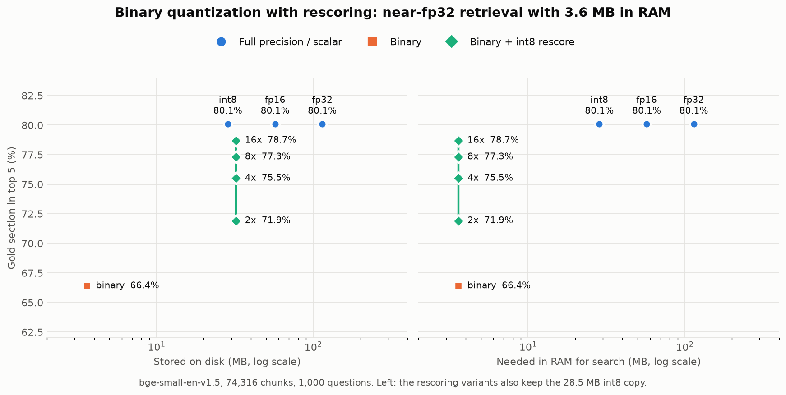

# rag-embedding-quantization

How much retrieval quality do you lose when you quantize the embedding model of a RAG system, and how much memory and latency do you save?

Built on the retrieval pipeline of my [very-simple-rag](https://github.com/BWork0/very-simple-rag) project (self-contained here: nothing needs to be installed from it). Uses the [Open RAG Benchmark](https://huggingface.co/datasets/vectara/open_ragbench) (arXiv papers) and its gold labels to measure retrieval.

## Summary

Measured on 74,316 chunks of arXiv papers and 1,000 benchmark questions (metric: the gold section is in the top 5; fp32 scores 80.1%):

- **int8 vectors:** 4x smaller, 80.1% (no detectable loss).
- **Binary vectors + int8 rescoring (16x candidates):** 3.6 MB in RAM instead of 114 MB (32x less), 78.7%. Plain binary without rescoring scores 66.4%.
- **int8 model (ONNX dynamic quantization):** 3.9x smaller, 1.64x faster to embed on the test CPU, 80.4% (no detectable loss).
- **Side finding:** fastembed's "bge-small-en-v1.5" ships fp16 weights, not fp32.

See [Trade-offs](#trade-offs-and-recommendations) for what to pick and what these results do not show.

## Setup

```sh
uv sync
uv run ingest.py                 # all 1000 papers (~740 MB) -> index/chunks.json (74,316 chunks)
uv run evaluate.py --queries 1000                       # storage formats
uv run --group onnx onnx_quantize.py --queries 1000     # model quantization (embeds the corpus twice)
```

Use `ingest.py --max-docs 50` and `--queries 200` for a quick run. Embedding the full corpus is slow on CPU (about 2.3 hours on the machine below); the fp32 vectors are cached in `index/`, so re-runs skip it.

Run the tests with `uv run pytest` (about a second; they use random vectors and need no data).

## Method

- **Model:** `BAAI/bge-small-en-v1.5` via fastembed (ONNX). Note that fastembed's copy of this model has **fp16 weights** (all 149 weight tensors are FLOAT16, despite the `-Q` in its source repo name `Qdrant/bge-small-en-v1.5-onnx-Q`). The storage-format results below therefore start from vectors produced by an fp16 model, stored as fp32 (the model-quantization results show this made no difference to retrieval). The model-quantization comparison uses the official fp32 export as its baseline.
- **Chunking:** ~1500-character chunks with 200 overlap, paper title prepended before embedding.
- **Retrieval:** cosine similarity, top 5.
- **Metrics:** gold paper in top 5, gold section in top 5, index size, embedding time, query latency.
- **Same questions for every variant** (fixed seed).

## Results: storage formats

Full corpus: 1000 papers, 74,316 chunks, 1000 benchmark questions. fp32 embedding took 8395 s. Machine: Windows 10 + WSL2, i7-11700K.

| Variant | Stored (MB) | RAM (MB) | Paper hit@5 | Section hit@5 | Top-5 overlap with fp32 |
|---|---|---|---|---|---|
| fp32 (baseline) | 114.1 | 114.1 | 93.5% | 80.1% | 100.0% |
| fp16 | 57.1 | 57.1 | 93.5% | 80.1% | 99.8% |
| int8 | 28.5 | 28.5 | 93.4% | 80.1% | 98.6% |
| binary | 3.6 | 3.6 | 85.8% | 66.4% | 45.6% |
| binary + int8 rescore (2x) | 32.1 | 3.6 | 89.0% | 71.9% | 61.4% |
| binary + int8 rescore (4x) | 32.1 | 3.6 | 91.1% | 75.5% | 72.8% |
| binary + int8 rescore (8x) | 32.1 | 3.6 | 91.6% | 77.3% | 81.3% |
| binary + int8 rescore (16x) | 32.1 | 3.6 | 92.4% | 78.7% | 87.4% |



The raw numbers behind the table and plot are in [`results/full_corpus.json`](results/full_corpus.json) (transcribed from the printed `evaluate.py` table, so values carry the table's rounding). Regenerate the plot with `uv run --group plot plot.py`.

"Nx" means binary search fetches 5 × N candidates, which are then rescored with the fp32 query against their int8 vectors.

Search latency (ms/query): fp32 4.62, fp16 69.14, int8 88.49, binary 3.42, binary + rescore 3.5–3.9 for every multiplier. fp16 and int8 are slow only because numpy has no fast fp16 or int8 matrix multiply, so they are cast to fp32 on every search; do not read that as a property of the formats. The rescore multipliers can be compared with each other (rescoring 80 candidates adds well under 1 ms over plain binary), but not with an optimized int8/popcount implementation.

### Findings

- **fp16 and int8 are free.** Section hit@5 is identical to fp32 (80.1%) at 2x and 4x smaller storage. With 1000 questions, one point is about 10 questions and the standard error is about 1.3 points, so differences of 0.1 are noise.
- **Binary is cheap but lossy.** 32x smaller (3.6 MB), but section hit@5 drops from 80.1% to 66.4%, and its top 5 shares only 46% of chunks with fp32.
- **Rescoring wins back almost all of the loss, with diminishing returns.** Section hit@5 climbs 66.4% (no rescore), 71.9% (2x), 75.5% (4x), 77.3% (8x), 78.7% (16x). Each doubling gains less (+5.5, +3.6, +1.8, +1.4 points). At 16x the result is 1.4 points below fp32 (80.1%), which is close to the noise level of this evaluation, with only 3.6 MB in RAM. The int8 copy (28.5 MB) still has to be stored, e.g. on disk, and 80 candidate vectors must be read from it per query.
- **Rescoring cost is small here.** The extra latency from 2x to 16x is about 0.4 ms in this numpy setup, but on a disk-backed int8 store the reads would likely dominate. That was not measured.
- **Corpus size matters.** On a 50-paper subset (3,809 chunks) binary looked much better (78.5% vs 85.0% for fp32, a 6.5-point gap). On the full corpus the gap is 13.7 points, because more chunks means more near neighbours for coarse 1-bit vectors to confuse.
- **Limits:** one embedding model, one dataset, query vectors not quantized, and the rescore sweep stops at 16x (the curve was still rising slowly).

## Results: model quantization (ONNX dynamic int8)

The sections above change how vectors are *stored*. This one quantizes the embedding *model* itself: the official fp32 ONNX export of `bge-small-en-v1.5` is converted with onnxruntime's dynamic int8 quantization (weights stored as int8, activations quantized at run time). Each model embeds the full corpus and its own queries, and is scored with plain fp32 search over its own vectors.

| Model | Model size (MB) | Embed time (s) | Chunks/s | Paper hit@5 | Section hit@5 | Top-5 overlap with fp32 model |
|---|---|---|---|---|---|---|
| fp32 (official ONNX export) | 133.1 | 8433 | 8.8 | 93.5% | 80.1% | 100.0% |
| int8 (dynamic quantization) | 33.8 | 5172 | 14.4 | 93.2% | 80.4% | 71.1% |
| fp16 (fastembed's model) | 66.5 | 8395 | 8.9 | 93.5% | 80.1% | 99.8% |

Same machine and corpus as above (74,316 chunks, 1,000 questions), CPU only (`CPUExecutionProvider`). Raw numbers: [`results/model_quantization.json`](results/model_quantization.json). Reproduce with `uv run --group onnx onnx_quantize.py --queries 1000`; `--check` first verifies that my embedding code reproduces fastembed's vectors (mean cosine 1.00000) and reports the int8-vs-fp32 cosine (0.980 on 64 chunks).

- **No detectable quality loss.** Section hit@5 is 80.4% for int8 vs 80.1% for fp32 and paper hit@5 is 93.2% vs 93.5%; these are 3 questions each way, inside the noise (about ±1.3 points at this sample size). This shows no loss was detected, not that int8 is better.
- **3.9x smaller and 1.64x faster to embed here.** On a laptop CPU (Ryzen 5 3500U) the same int8 model was only about 1.1x faster in a small test (150 chunks), so the speed-up depends on the CPU. The workstation CPU has int8 vector instructions that the laptop CPU lacks; I did not isolate that as the cause.
- **The rankings still change.** Only 71.1% of the int8 model's top-5 chunks are the same as fp32's (99.8% for the fp16 model), even though the gold hit rate is unchanged. This evaluation cannot say why; it only checks whether the gold paper and section appear in the top 5, not what else is there.
- **The fp16 model matches fp32.** Hit rates are identical and the model embeds at the same speed on CPU, so the storage-format results above are not an artifact of starting from fp16 weights.
- **Limits:** dynamic quantization only (no static calibration, no quantization-aware training), one model, CPU only, one run per model (no repeat to measure run-to-run variation in time), and the int8 model was not combined with the binary-vector formats.

## Trade-offs and recommendations

Pick by what is scarce. Numbers are from this benchmark (section hit@5, fp32 = 80.1%) and may differ on other data.

| If you are constrained by... | Use | Evidence |
|---|---|---|
| Little: just want it smaller for free | int8 vectors (or fp16) | 4x (2x) smaller, hit rate identical to fp32 |
| RAM, with a larger store (disk/SSD) available | binary vectors in RAM + int8 rescoring from disk, 16x candidates | 3.6 MB RAM, 78.7% (1.4 points below fp32); more candidates close more of the gap, with shrinking gains |
| RAM, and quality barely matters (e.g. a coarse prefilter) | binary only | 32x smaller, 66.4% (13.7 points lost) |
| Model size or embedding throughput | int8 model | 3.9x smaller, 1.64x faster here, no detectable loss; check on your own data |

Things worth knowing before relying on this:

- **At this scale none of it is needed.** The whole fp32 index is 114 MB. The savings matter at much larger corpora: by simple arithmetic (384 dims), 100 million chunks need about 154 GB in fp32, 38 GB in int8 and 4.8 GB as binary. This extrapolation is arithmetic, not a measurement.
- **Binary quantization gets worse as the corpus grows.** On a 50-paper subset (3,809 chunks) it lost 6.5 points of section hit@5; on all 1000 papers it lost 13.7. I expect the gap to keep growing with corpus size, but I did not test larger corpora.
- **Rescoring has a ceiling.** The int8 rescoring step can only reorder the candidates that the binary step returned. A gold chunk missing from the 5 × N binary candidates is lost no matter how good the rescoring is, which is why the curve flattens as N grows.
- **Rescoring needs the int8 vectors stored too** (28.5 MB here, 32.1 MB total with the binary index). The RAM saving is real; the storage saving is not, and reading candidates from disk costs time that these numpy-based latency numbers do not capture.
- **Latency numbers in this repo are not a speed comparison of the formats** (numpy has no fast fp16/int8 matrix multiply). Use them only to compare the rescoring multipliers with each other.
- **The int8 model reorders rankings noticeably** (71% top-5 overlap with fp32) with no change in hit rate. That is not explained here; on a task where the exact top-5 matters beyond a gold-label check, test it separately.
- **Statistical resolution:** 1,000 questions gives about ±1.3 points of standard error on an 80% rate, so differences under about 2 points should not be read as real.

### Failure cases: not analyzed yet

The evaluation reports aggregate hit rates only. I have not looked at which individual questions the quantized variants get wrong, whether they cluster by paper, section type or question wording, or whether the same questions fail for binary and for the int8 model. The explanations above (corpus-size effect, the rescoring ceiling) follow from how the methods work or from the 50-vs-1000-paper comparison; they were not confirmed by inspecting failures. A per-question analysis is on the roadmap.

## Roadmap

- [x] Project scaffold, fp32 baseline eval
- [x] Embedding storage quantization: fp16, int8, binary (with rescoring)
- [x] Rescore multiplier sweep (2x, 4x, 8x, 16x)
- [x] Model quantization: ONNX int8
- [x] Results table and quality-vs-size plot
- [x] Write-up of trade-offs
- [ ] Per-question failure analysis (which questions each variant loses, and why)
- [ ] Combine the int8 model with binary vectors, and test a larger corpus
